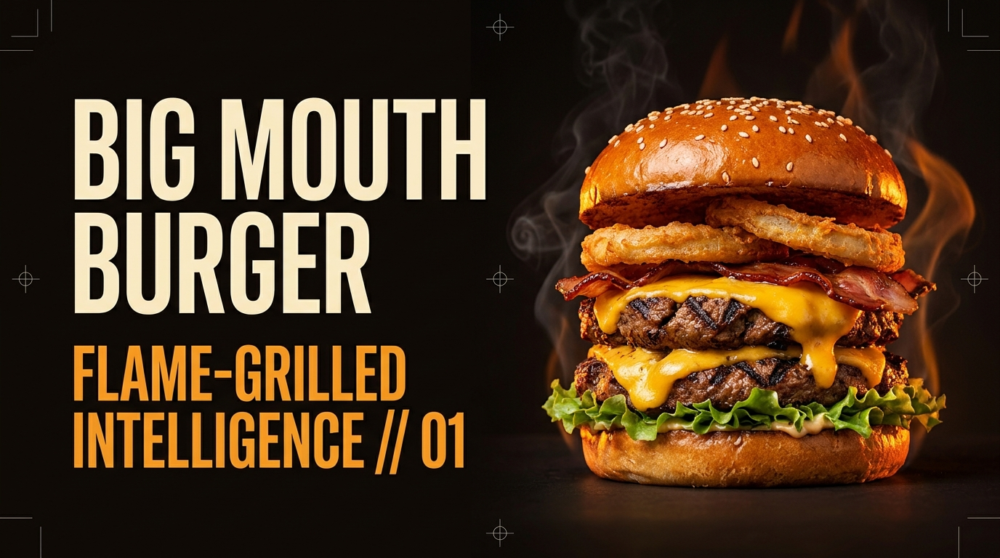
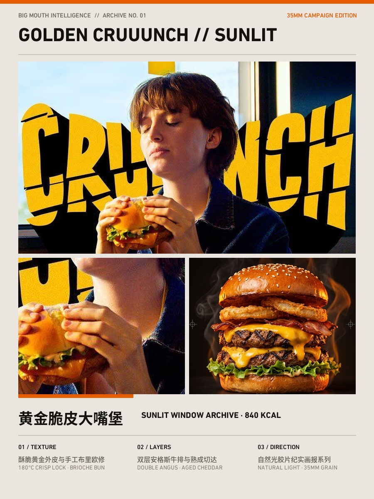
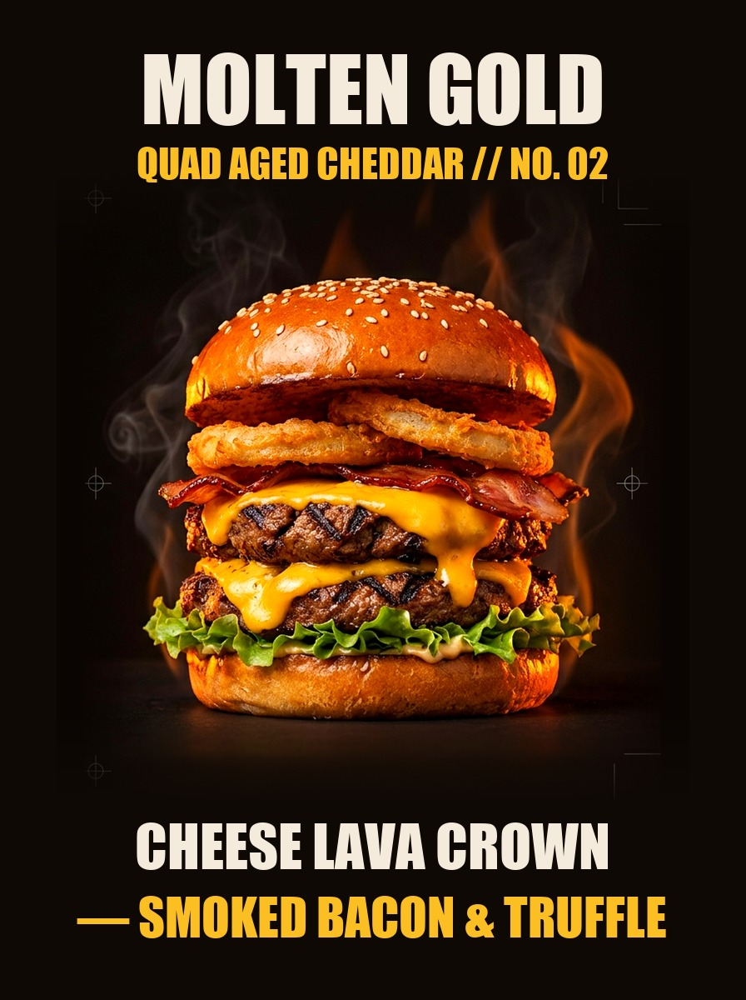
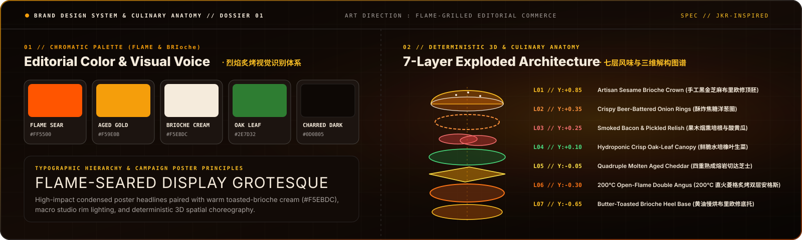
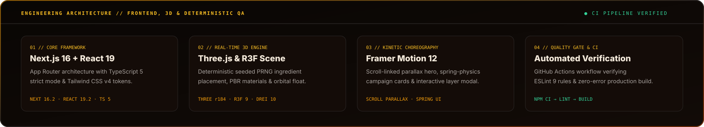

<div align="center">

<!-- ===================================================================== -->
<!-- 00 // HERO CAMPAIGN BANNER (FLAME-GRILLED INTELLIGENCE)               -->
<!-- ===================================================================== -->


<br/>

# BIG MOUTH BURGER INTELLIGENCE · 大嘴堡情报局

**200°C Open-Flame Editorial Commerce · High-Impact Campaign Lookbook · Deterministic 3D Web Study**

<sub>
  A luxury fast-casual brand &amp; spatial web concept inspired by <b>Cannes Lions flame-grilled advertising posters</b>, <b>warm brioche-cream typography</b>, and <b>real-time Three.js / React Three Fiber product choreography</b>.
</sub>

<br/><br/>

<!-- ===================================================================== -->
<!-- 01 // CAMPAIGN POSTER LOOKBOOK (3:4 PROMOTIONAL TRIPTYCH)             -->
<!-- ===================================================================== -->
<p align="center">
  &nbsp;&nbsp;
</p>

<sub>
  <b>CAMPAIGN TRIPTYCH //</b> &nbsp;
  <code>NO. 01 FLAME SEARED (烈焰双层安格斯)</code> &nbsp;·&nbsp;
  <code>NO. 02 MOLTEN GOLD (四重芝士熔岩堡)</code> &nbsp;·&nbsp;
  <code>NO. 03 CRIMSON HEAT (赤焰秘制脆皮堡)</code>
</sub>

<br/><br/>

<!-- ===================================================================== -->
<!-- 02 // BRAND IDENTITY & 7-LAYER EXPLODED BURGER ANATOMY                -->
<!-- ===================================================================== -->


<br/><br/>

<!-- ===================================================================== -->
<!-- 03 // ENGINEERING STACK & DETERMINISTIC QA                            -->
<!-- ===================================================================== -->


</div>

<br/>

## ⚡ Quick Start & Verification

```bash
# Install dependencies
npm install

# Start local development server (http://localhost:3000)
npm run dev

# Run ESLint & production build verification
npm run lint
npm run build
```

---

<div align="center">
  <sub>
    <b>BIG MOUTH BURGER INTELLIGENCE (大嘴堡情报局)</b> · Art Direction &amp; Spatial Engineering by <a href="https://github.com/YNS34-hub"><b>Jace (YNS34-hub)</b></a><br/>
    All commercial details, prices, and culinary dossiers exist exclusively for this brand &amp; interface design study.
  </sub>
</div>
